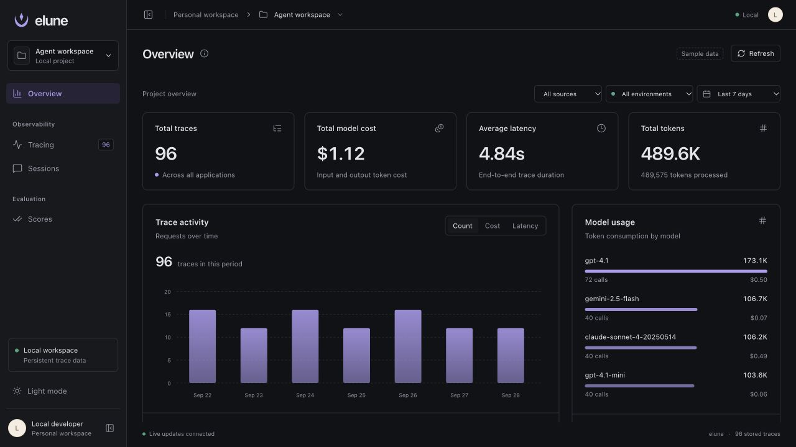
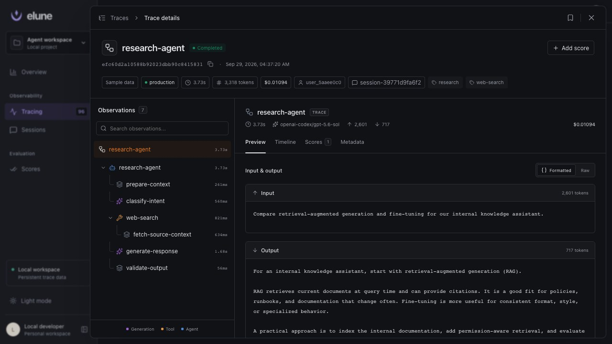
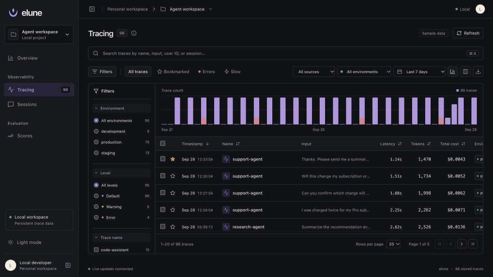
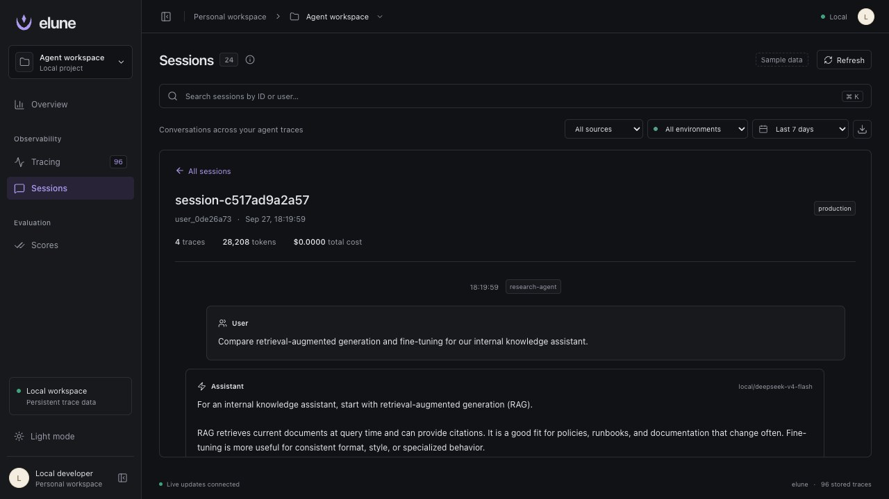
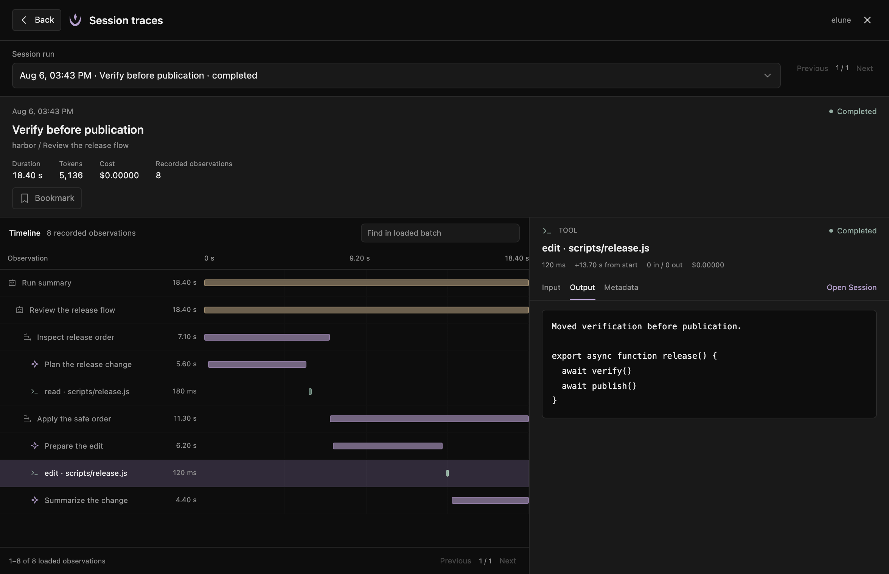

# elune

Inspect AI agent traces, model costs, tool calls, sessions, and scores on your computer. Run the standalone Vue 3, Vite, Go, and SQLite app, or embed tracing in a Node.js host.

<table>
  <tr>
    <td width="50%"><strong>Overview</strong><br><a href="docs/screenshots/overview.jpg"></a></td>
    <td width="50%"><strong>Trace details</strong><br><a href="docs/screenshots/trace-detail.jpg"></a></td>
  </tr>
  <tr>
    <td width="50%"><strong>Traces</strong><br><a href="docs/screenshots/traces.jpg"></a></td>
    <td width="50%"><strong>Sessions</strong><br><a href="docs/screenshots/sessions.jpg"></a></td>
  </tr>
</table>

Sample data only. Select an image to open it at full size. [View scores](docs/screenshots/scores.jpg).

## Embed in a host application

Install the framework-neutral `@elune/embedded` package directly from this repository. It needs Node.js 22.19 or later, with no separate service or sibling checkout.

```sh
npm install spmurrayzzz/elune
```

Use the core store and Pi adapter for in-process capture. Optional Vue 3 views provide an inspector, a session workspace, and a cross-project explorer. Import `@elune/embedded/vue/style.css` explicitly when using them.

[Embedding guide](docs/embedding.md): store API, Pi lifecycle and child usage, Vue client and navigation contracts, content limits, and host privacy duties.

<a href="docs/screenshots/embedded-workspace.png"></a>

Sample embedded views: [inspector](docs/screenshots/embedded-inspector.png), [workspace](docs/screenshots/embedded-workspace.png), [explorer](docs/screenshots/embedded-explorer.png).

## Start the standalone app

Requirements: Go 1.25 or later, Node.js 22.19 or later, npm, and Make.

From the repository root, run:

```sh
make run
```

Open [elune](http://127.0.0.1:8080).

With `make run`, the app saves data in `backend/data/elune.db`. SQLite uses WAL mode to allow reads during writes.

For a new database, elune imports `backend/data/store.json` if that file exists. It keeps the original JSON file unchanged. Without existing data, it creates 96 sample traces.

For frontend development, keep the backend running. In a second terminal, run `npm --prefix frontend run dev`. Open `http://127.0.0.1:5173`.

## Keep data private

- Keep elune and `PI_TRACE_URL` local. The server has no user authentication or built-in encryption. Do not expose it through a public proxy or tunnel.
- Traces can contain prompts, tool results, file paths, and secrets. The HTTP exporter does not remove secrets. Review exports and screenshots before sharing them.
- Database files and trace queues are not encrypted. Git ignores `backend/data/` and `work/`. Exclude custom storage paths and exports from version control.
- Pi sends model requests to your selected provider. The HTTP exporter sends traces to `PI_TRACE_URL`.

## Connect Pi to the standalone app

`integrations/pi/` exports traces over HTTP to `PI_TRACE_URL`. It needs the standalone server. Embedded hosts use `@elune/embedded/pi` without that service or environment variable.

Use an installed Pi coding agent with access to a model. The integration checks used Pi 0.81.0.

With elune running, start Pi from the repository root in another terminal:

```sh
pi -e ./integrations/pi
```

Send a request in Pi. Select **Live Pi** in elune to inspect the trace.

To enable the package for future Pi sessions, run `pi install ./integrations/pi` from the repository root. This changes your Pi user settings.

The extension captures retries, canceled runs, and context compaction. It saves pending traces locally and retries delivery if elune is unavailable.

## Configuration

These variables configure the standalone backend and HTTP exporter. Set them before you start the related process. Embedded hosts configure the library through its API.

| Process | Variable | Default |
| --- | --- | --- |
| Backend | `PORT` | `8080` |
| Backend | `DATA_PATH` | `data/elune.db` |
| Backend | `FRONTEND_DIST` | `../frontend/dist` |
| Pi | `PI_TRACE_URL` | `http://127.0.0.1:8080` |
| Pi | `PI_TRACE_ENVIRONMENT` | `local` |
| Pi | `PI_TRACE_QUEUE_DIR` | `.elune-queue` inside the Pi session directory |

Backend paths are relative to its working directory. `make run` starts the backend from `backend/`.

If `DATA_PATH` ends in `.json`, elune imports that file into the same path with a `.db` extension.

## Run checks

Run these commands from the repository root:

```sh
npm --prefix frontend test
npm --prefix integrations/pi test
(cd backend && go test -race ./... && go vet ./...)
make build
```

The real Pi integration check needs a running backend and valid model access. It makes real model requests and can incur charges.

```sh
npm --prefix integrations/pi run test:integration
```

The default test model is `openai-codex/gpt-6-sol`. Set `PI_TEST_MODEL` to use another available model.

The check saves fixtures, Pi sessions, and trace queues in `work/pi-integration/`. It also adds test traces to the configured backend.

## License

Copyright 2026 Stephen Murray.

Licensed under the [Apache License, Version 2.0](LICENSE).
